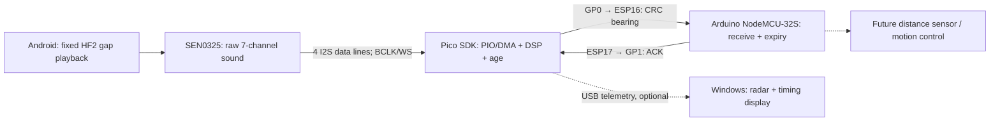

# Architecture, responsibilities and integration risks

Solid arrows are current; the final motion block is future work. The computer performs no acoustic FFT/fit in this branch. The archived combo instead sends PCM over USB and computes on Windows.

## Result path
Pico captures 4096 samples per channel, correlates the fixed HF2 template, finds candidate arrivals, fits the array geometry, applies code confirmation and checks measurement age. Only core0 is used, at 120 MHz. UART sends a session/sequence/age/valid/angle/quality record protected by CRC16. ESP validates framing, CRC, session, sequence and freshness, then ACKs. USB diagnostics report the actual packet, independently of the control target.

An invalid packet may contain a useful finite diagnostic angle. That does not authorize steering. No fit is sent with zero angle/quality, but a real 0° direction is also legal; the current eight-field frame has no fit-valid or reason field. Consumers must obey valid/expiry rather than infer validity from the angle. Read the [exact protocol](../esp32-link/gap_receiver/README_EN.md).

Pico limits fresh measurements to 480 ms. ESP adds a 20 ms UART allowance and expires a target once total age exceeds 500 ms. A repeated/old/session-invalid packet never refreshes an old target. ACK roundtrip includes foreground polling, so it is not pure wire delay. Set Display Front in Windows is display-only; array-to-chassis calibration must be separately defined for control.

## Future control-loop sketch
```text
on new validated bearing:
    if target_valid and age_with_transport <= expiry:
        target = calibrated_array_to_chassis(bearing)
        target_timestamp = measurement_timestamp
    else:
        invalidate_target()

every fixed control tick:
    read_distance_and_obstacles()
    if emergency or target_expired or target_invalid:
        request_safe_stop()
    else:
        error = shortest_signed_angle(target, current_heading)
        command = rate_limited_controller(error, distance)
        apply_motor_limits(command)
```
This pseudocode is not installed. Calibrate sign and robot front before motion. Rate-limit motor commands, not the incoming physical angle. Large source-direction changes must remain observable.

## Predicted bugs and checks
| Risk | Symptom | Check / boundary |
|---|---|---|
| Stale estimate used as fresh | Robot steers toward an old location | Keep measurement age; do not timestamp at UI draw |
| Confirmation interval too long | Fits exist but target never valid | Current ~885 ms phone cycles exceed 750 ms confirmation gap; optimize timing before relaxing criteria |
| GPIO reused by motors/PSRAM | UART disappears or actuator conflict | Reserve pins explicitly; this tested NodeMCU has 16/17 free |
| Reversed angle/sign or channel map | Opposite turns despite clean packets | Known-angle bench sweep; USB display offset does not calibrate UART |
| Reboot/session/sequence wrap | Old frame revives target | Existing parser tests; boot clears target and starts fresh session |
| USB backlog on opening | Repeated/truncated initial logs | Bounded startup raw capture + one clear + LF alignment; no mid-trial dedup |
| Reflection / narrow-band ambiguity | Angle jumps or inconsistent arrivals | Record known angle and raw diagnostic evidence; never block merely large turns |
| Other code accepted | False trigger in interference | Known wrong-code negatives still fail; not certified anti-interference |
| Slow control mixed into DSP | Missed DMA service or extra delay | Respect 10.667 ms DMA block deadline; measure worst-case time, stack and IRQ contention |
| Phone import mismatches template | Sound plays but no match | Standalone template fixed; choose paired HF2 file |
| Distance inferred from radar rings | Incorrect follow distance | Rings are decorative; use separate distance sensor |

## Why communication first
Earlier Pico phone timing: DSP ~789 ms, cycle ~885 ms, final fit only ~6 ms. Moving only the final fit to ESP would not halve that delay. UART ACK timing is ~7–8 ms, much smaller. The user chose to preserve this processor arrangement and complete communication before further FFT/dual-core work.

Seven-channel PCM cannot be moved through this 115200 UART (672 kB/s versus 11.52 kB/s capacity). Sending compact results avoids that bandwidth problem. Spare static RAM is not proof of spare scheduling capacity: no runtime stack/heap high-water or complete CPU-utilization measurement has been collected.
