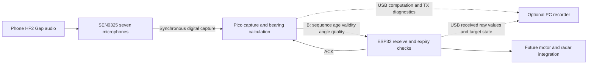

# SEN0325 → Pico → ESP32 communication notebook

Updated 12 November 2026, through Flash trial 05 (no Pico USB reader). Both firmwares have been written and verified. Continued transmission without a Pico USB reader was observed. Physical cold start and warmed-up phone playback remain separately recorded checks.

[中文](COMMUNICATION_NOTEBOOK_ZH.md) · [Setup](README_EN.md) · [Algorithm and resource decisions](DESIGN_NOTEBOOK_EN.md)

## 1 Scope and decisions

Further FFT and dual-core optimization is paused. Keep the existing boards and the tested FAST integer estimator; first establish observable microphone → Pico → ESP32 communication. Do not change the 18–22 kHz HF2 Gap waveform, 48 kHz sampling, 4096-frame window or PNR threshold. Do not veto a direction because it differs substantially from the previous one.

The immediate acceptance question is whether a specific Pico result reaches ESP32 unchanged, receives the correct validity treatment, and is acknowledged back to Pico. This does not establish physical angular accuracy, freshness or stable motor control.

Keep the [mature Pico + PC combination](../legacy/pico+computer%20combo%20sensoring%20version/README.md) and its ZIP unchanged. The compute checkpoint `pico-standalone-compute-checkpoint-2026-11-12` (external local archive, not shipped) separately preserves tested FAST RAM, undeployed historical FAST Flash and offline-only W1C1. Dual-core remains a design, not implemented firmware. The newer v0.2 communication Flash deployment does not change the historical checkpoint's status.

## 2 Responsibilities and wiring



Pico computes; ESP32 receives, acknowledges and manages target validity. The PC records diagnostics without estimating direction. No motor actions are implemented.

| Pico | NodeMCU ESP-32S | Purpose |
|---|---|---|
| GP0, physical pin 1 | P16 / GPIO16 | Pico TX → ESP RX |
| GP1, physical pin 2 | P17 / GPIO17 | Pico RX ← ESP TX |
| GND, e.g. physical pin 3 | GND | Common ground |

115200 8N1 and 3.3 V logic. Separate USB power; do not join 3V3, 5V or VIN between boards. The ESP console RX/TX pins are not P16/P17. Keep SEN0325 GP6–GP13 unchanged and disconnect power before rewiring.

See [design notebook section 11](DESIGN_NOTEBOOK_EN.md#11-board-timing-and-bandwidth-budget) for calculations: a maximum-size B record is 49 bytes, about 4.25 ms on the wire at 115200 8N1. That is not total latency. This link sends results, not seven-channel PCM; Pico computation remains the principal delay.

## 3 What v0.2-link_diag changes

### Diagnostic values and valid targets are distinct

The existing eight-field B payload is preserved:

```text
@B,1,SESSION8HEX,seq,age_ms,valid,angle_cdeg,quality*CRC16\n
```

| Condition | Angle / quality | valid | Receiver use |
|---|---|---|---|
| Finite fit, but stale or unconfirmed | Keep this fit for diagnosis | 0 | Display raw values; do not steer |
| No fit, invalid capture override or nonfinite values | 0 / 0 | 0 | No usable new bearing |
| Fit, confirmation and freshness satisfied | Current bearing and quality | 1 | Still check session, sequence and expiry |

Zero degrees is a legitimate direction. B has no `fit_valid`, `confirmed` or detailed failure reason. Neither zero/nonzero angle nor quality proves a fit exists or gives a probability of accuracy. Consult matched Pico USB diagnostics for those details.

ESP32 v1.1 prints the received `raw_cdeg`, `raw_q` and `source_age_ms` separately from `target_valid`. It does not print an old target angle under a new packet sequence. A stale explicit-invalid record may be labelled `DIAG_STALE` while ACK status remains 1, because the original invalid branch has priority. This never makes it a usable target. See the [receiver protocol](../esp32-link/gap_receiver/README.md) for full classifications.

### Transmission and receipt have separate evidence

- Successful UART launch updates `tx_result_seq`, `tx_age_ms`, `tx_valid`, `tx_angle_cdeg` and `tx_quality`. Failure does not manufacture a successful TX record.
- A bearing ACK must pass CRC, session, B type and current pending-sequence checks. Old, duplicate and wrong-session records cannot replace it.
- H handshake ACKs do not overwrite B `ack_seq`, RTT or status. H/P traffic does not renew an old direction.
- RTT starts just before the first UART FIFO write and ends when the foreground loop parses the matching ACK. It includes polling delay, not just wire time.
- A later GAP line can contain the previous B's ACK metadata. Match `ack_seq`; do not assume a line's ACK belongs to its newest TX.

Confirmation still requires two code hits separated by less than 750 ms using window-center timestamps. Expiry remains 500 ms including a 20 ms transmission allowance. Age is calculated from the sampled window center; no fake zero age or relaxed expiry hides slow computation.

## 4 Exact platform, versions and deployed identities

| Platform | Actual configuration |
|---|---|
| Pico | Native C11/C++17, **Pico SDK 2.3.1**, not Arduino; `pico` / `rp2040`, 120 MHz core0 |
| Pico compiler | **Arm GNU Toolchain 14.2.Rel1**, build arm-14.52; GCC/G++ **14.2.1** 20241119 |
| Pico build/write tools | CMake **4.4.4**, Ninja **1.13.2.git.kitware.jobserver-pipe-1**, picotool **2.3.1** |
| ESP editor/build | **Arduino IDE 2.3.8**, **CLI 1.4.1**, **esp32 by Espressif Systems 3.3.12** |
| ESP board | **NodeMCU-32S / classic ESP32, not ESP32-S3**; `esp32:esp32:nodemcu-32s` |
| ESP write tool / local port | esptool **5.5.0**; COM6 on this machine only |
| Optional recorder | Python **3.12.4**, pyserial **3.5** |

The actual Pico build's compiler configuration and local version commands were inspected. See the [design platform table](DESIGN_NOTEBOOK_EN.md#0-platform-and-toolchain) for the SDK commit and flags. Current Pico Flash enumerates as local COM8; earlier RAM tests used COM5. Re-detect identity instead of hard-coding the old port.

| Image | State and SHA256 |
|---|---|
| Pico RAM v0.2, trials 01/02 | Loaded for testing: `7822b95524771d02305743715eeb17d09938065297edf0ed902e99ea9ddc8fb9` |
| Pico Flash v0.2 | Written and verified with `load -v`; trials 03/04 observed: `11958e9310926e856f01359c10c4832cffc046cb64a8edebe675b76e3984caa0` |
| ESP32 desktop-sketch merged image | Written and hash verified; used in trials 03/04: `36610897ee2f78f5fe8153d043df68cbb00b5a7cf040c7d3475dc2b3d77cda6b` |
| W1C1 | Offline verified and built, not board tested/deployed |
| Dual core | Design only, not implemented |

The authorized local desktop copy `sketch_nov12a` contains the receiver entry `.ino`, protocol, diagnostic and self-test headers, and `sketch.yaml` selecting NodeMCU-32S / COM6. Its blank original is privately backed up. Independent compilation passed with 277624 program bytes and 22932 global-data bytes; these are not runtime free-memory figures. GUI automation was stopped. No EE474 source or existing motor-controller code was changed. Verified writes do not by themselves prove sustained operation or cold-start behavior.

## 5 Verification results

### Native logic checks

The public entry points are `tests/test_main_communication.py` (source auto-discovery, configurable host compiler, external output) and `tests/host_link_test.c`; reproducible commands are in [README_EN](README_EN.md#reproduce-host-communication-checks). Both were re-run after publication-path cleanup, with 107/41 checks passing. No device access is required.

Pico actual-main extraction tests passed 107 assertions, Pico link checks 41, and ESP checks 57. The main harness uses real extracted functions with mocked UART/time/USB and additionally exercises UART writes through a register mock. It covers failed TX, no fit/override/nonfinite values, sequence wrap, age clamping, wrong/old/duplicate ACKs and H preserving B metadata. The maximum tested GAP line was 699 bytes, within the 1024-byte buffer. Native checks do not replace power, reconnect or acoustic tests.

### Trial 01: RAM background and link recovery observation

38 Pico windows, 38 current TX records and 38 ESP B records matched exactly. There were 37 later Pico confirmations of the matched ESP ACKs, no interior missing observations and no parsing errors. The analysis verdict was `consistent_observed_overlap`. One tail-boundary ACK observation remains uncertain; it is neither proven lost nor proven harmless.

All 38 windows had zero code-positive microphones and no fit/valid target. ESP classification was 37 `DIAG_STALE` and one `RX_REJECTED`. Medians: age 764 ms, DSP 719.008 ms, cycle 810.181 ms, matched B ACK RTT 7.165 ms. Matching fields does not mean the receiver should accept the records as control targets.

### Trial 02: RAM phone beacon

34 Pico windows/TX records yielded 33 exact matching ESP B records and 32 later Pico ACK confirmations. All 34 windows had seven code-positive microphones; 32 had fits, two had inconsistent arrivals, and final valid was zero throughout. Medians: age 834 ms, DSP 789.160 ms, cycle 884.558 ms, matched RTT 7.844 ms.

One TX at the observation start lacks an ESP observation. Tail boundaries also limit later ACK confirmation. These differences are not automatically UART loss. The trial contained **4453 repeated startup-prefix observations and one malformed STAT**. Overall verdict: **`inconsistent_observation`, not passed**. Exact matched fields cannot erase that finding.

### Trial 03: Flash warmed-up background

Over 30 seconds on Pico COM8 and ESP COM6, 37 windows/TX records matched 37 ESP B records exactly. There were 37 CRC-valid ACKs and 36 later Pico confirmations. Interior missing observations, parse errors, field conflicts and relevant error-counter increases were zero; the final ACK remains bounded by recording end.

Medians: DSP **719.932 ms**, cycle **809.641 ms**, age **765 ms**, matched ACK RTT **7.2765 ms**. Startup handling captured 9063 bytes, aligned at LF after 1.125 seconds and did not deduplicate the formal observation midstream. This supports clean background-link observation after the monitor change, not acoustic direction accuracy.

### Trial 04: Flash software reboot

After picotool `reboot -f`, 12 seconds yielded 14 TX / 14 exact matches, 14 CRC-valid ACKs and 13 later Pico confirmations, with zero parse errors. A new session and sequence restart were observed; sequence values ranged from 1 to 21, including other protocol messages. The numerical sequence span is not a B-loss count.

This establishes software-reboot recovery, **not a physical power cycle**. Trial 05 checks absence of a Pico reader separately from disconnecting USB data or starting on an independent supply.

### Trial 05: no Pico USB reader

The recorder opened only ESP COM6 for 12.109 seconds and sent no scan command. Its 35 events contain 15 consecutive BEARING sequences 48–62, 14 CRC-valid ACKs 49–62 and six STAT lines. The first-to-last event span is 11.359 seconds, distinct from total recording duration. STAT count advanced from 28 to 40; bad, lines, ack_drop and usb_drop stayed zero. The first BEARING is at the observation boundary, so a missing seq48 ACK observation is not automatically a lost ACK.

This establishes continued result transmission while no PC client reads Pico USB. With no Pico reader, this trial does not observe Pico-side ACK receipt or prove that USB data was physically disconnected. It is not a power-cycle or independent-supply test.

### Limits shared by these results

The 0.2–0.5 s real-delay target remains unmet. Measurement ages exceed 500 ms, and current cycles exceed the 750 ms confirmation interval; no usable target is established. Phone ground-truth direction was not labelled, so 32/34 fits is not angular accuracy. ACK RTT is not sound-to-motion latency. Preserve user audio pauses as experiment context instead of automatically labelling them communication bugs.

## 6 Evidence and reproducibility

The following are identifiers under the maintainer's private `comm-link-v0.2/` collection: **local evidence, not shipped**, not public download links. Sanitized summaries are planned at project `reports/communication-2026-11-12/` with `REPORT_EN.md`, `REPORT_ZH.md`, `metrics.json` and `figures/`. Do not publish raw recordings, runtime logs, device backups or personal absolute paths.

| Local relative identifier | Purpose |
|---|---|
| `analysis-trial-01-link-recovery/summary.json` | Background matched fields, ACK pairing, timing and boundaries |
| `analysis-trial-02-phone/summary.json` | Phone matches, fits, malformed STAT and failed overall verdict |
| `trial-01-link-recovery/`, `trial-02-phone/` | Private serial observations, not handoff templates |
| `native-main-communication-results.json` | 107 checks, source hash, compiler command and limits |
| `candidates/ram-link-v0.2-7822b955/` | RAM identity and resource audit |
| `candidates/flash-link-v0.2-11958e93/`, `pico-flash-load.log` | Flash identity and verified write |
| `desktop-blank-original/` | Original blank desktop-sketch backup |
| `desktop-sketch-build.log`, `desktop-sketch-verification/`, `desktop-sketch-upload.log` | Independent desktop build and verified merged image |

Correlate session, UART sequence and actual TX metadata. GAP/BEARING USB lines do not themselves carry session. Current analysis assumes one boot and a unique observed ACK session; multiple sessions/reboots need segmentation. ESP ACK logging establishes generation/queueing; matched later Pico metadata supplies receipt evidence. USB observation gaps alone do not prove UART wire loss.

## 7 Risks and remaining acceptance

| Risk | Current treatment | Remaining evidence |
|---|---|---|
| Stale raw angle used as steering | Separate raw and target validity; unchanged expiry | Motor integration must consume valid targets only |
| H/P or duplicates renew old data | Protocol and native coverage | Longer reconnect/expiry observation |
| Competing serial readers | One owner per port; no GUI automation | Launcher/recorder ownership checks |
| Startup/incomplete lines bias statistics | Trial 02 retained; warmed trials 03/04 have no parse errors | Warmed phone-beacon repetition |
| PC reading accidentally required | Autonomous firmware design | No-reader observation complete; independent-power cold start separately |
| Fit arrives too late | Report real age and validity | Resume compute work only after communication stage |
| Wrong-code acceptance or angular bias | Known limitations retained | Known-angle, distance and wrong-beacon comparisons |

| Next acceptance item | Current status |
|---|---|
| Pico Flash write/read verification | Complete for 11958e93; not a power-cycle result |
| ESP desktop merged image | Complete for 36610897, observed in trials 03/04 |
| Software reboot/session recovery | Observed in trial 04 |
| No Pico USB reader | Trial 05 complete: continued ESP reception; no physical USB-disconnection claim |
| Startup handling | Clean warmed background/reboot observations; phone retest pending |
| Known-angle accuracy and sound-to-output latency | Pending physical reference and synchronized timing |

No W1C1 deployment, dual-core implementation, angle-jump restriction or expiry relaxation was introduced by this communication stage.
