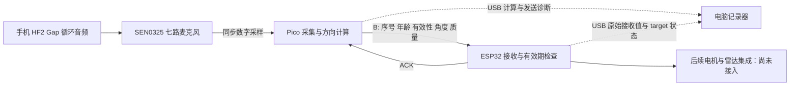

# SEN0325 → Pico → ESP32 通信阶段笔记

记录日期：2026-11-12。统计更新到 Flash trial 05（无 Pico USB 读者）。Pico Flash 与 ESP32 桌面草稿固件已写入并校验，无 Pico 读者时仍持续发送已观察；断电和暖机后手机试播仍需分别记录。

[English](COMMUNICATION_NOTEBOOK_EN.md) · [中文使用说明](README_ZH.md) · [计算设计依据](DESIGN_NOTEBOOK_ZH.md)

## 1 本阶段要完成什么

按最新决定，暂停进一步 FFT 和双核优化，不换开发板，先把麦克风、Pico、ESP32 的通信接通并做到可核查。使用现有 FAST 整数算法，不改 HF2 Gap 的 18–22 kHz 音频、48 kHz 采样、4096 点窗口、PNR 门限，也不添加“角度变化太大就拒绝”的设计。

这阶段要回答的是：Pico 产生的这条记录，ESP32 是否按原值收到了，是否作出正确的有效性判断，回执是否回到 Pico。它还不能证明声学方向准确、结果足够新鲜或车轮控制稳定。

保留的两个历史入口：

- [成熟 Pico + 电脑组合版](../legacy/pico+computer%20combo%20sensoring%20version/README.md)：原来由电脑定位的方案及其 ZIP；本阶段不改。
- 计算 checkpoint `pico-standalone-compute-checkpoint-2026-11-12`（维护者外部本地归档，不随公开项目分发）：已板测 FAST RAM、未部署 FAST Flash，以及仅离线验证的 W1C1。双核仅有设计笔记，没有实现。

## 2 分工和接线



Pico 负责计算；ESP32 负责接收、回执和目标状态。电脑当前只记录诊断，不代替 Pico 定位。没有电机控制动作。

| Pico | NodeMCU ESP-32S | 作用 |
|---|---|---|
| GP0 / 物理 1 脚 | P16 / GPIO16 | Pico TX → ESP32 RX |
| GP1 / 物理 2 脚 | P17 / GPIO17 | Pico RX ← ESP32 TX |
| GND / 物理 3 脚或其他 GND | GND | 共地 |

115200、8N1、3.3 V 电平。两板分别用 USB 供电，不连接板间 3V3、5V 或 VIN。ESP32 板上另印的 RX/TX 是控制台引脚，不是这里的 P16/P17。SEN0325 原有 GP6–GP13 分配不变，换线前断电。

带宽和采集资源计算沿用 [设计笔记第 11 节](DESIGN_NOTEBOOK_ZH.md#11-11-月-12-日实板计时与本阶段修正)：B 包最多 49 字节，115200 8N1 约 4.25 ms；它不是总延迟。串口只传结果，不能按当前波特率转发七路 PCM。当前慢的主要部分仍是 Pico 计算。

## 3 v0.2-link_diag 实际改动

### 诊断值与控制目标分开

保留原八字段 B 格式：

```text
@B,1,SESSION8HEX,seq,age_ms,valid,angle_cdeg,quality*CRC16\n
```

| 情况 | B 的 angle / quality | B 的 valid | ESP32 的使用方式 |
|---|---|---|---|
| 有有限数值的拟合，但过期或未确认 | 保留这次拟合用于诊断 | 0 | 显示 raw，不作为控制目标 |
| 没有拟合、采集被判无效或数值非有限 | 0 / 0 | 0 | 无可用新方向 |
| 拟合、确认、新鲜度均满足 | 发送本次方向和质量 | 1 | 再通过接收端会话、序号、有效期检查 |

**0° 本身是合法方向，不能看到 0 就断言没有拟合。** B 不包含 `fit_valid`、`confirmed` 和详细拒绝原因，也不能从 quality 推断概率或物理准确率。这些细节需要对照 Pico USB 诊断。

ESP32 v1.1 输出收到的 `raw_cdeg`、`raw_q`、`source_age_ms`，同时单独输出 `target_valid`。不会把旧目标角度填在新包的序号下面。过期的显式 invalid 包可能显示 `DIAG_STALE`，而 ACK 状态仍是 1；这是原协议 invalid 分支优先的结果，不代表它被接受为控制目标。完整分类见 [接收器说明](../esp32-link/gap_receiver/README.md)。

### 让“发送”和“收到回执”有对应证据

- Pico 只有成功启动 UART 发送后才更新 `tx_result_seq`、`tx_age_ms`、`tx_valid`、`tx_angle_cdeg`、`tx_quality`。发送失败保留原记录，避免把准备发送当成已经发送。
- 回执必须通过校验、会话、B 类型和当前待确认序号检查。重复、旧序号和错误会话不能替代本次 B 回执。
- H 握手回执不覆盖最后一次 B 的 `ack_seq`、`ack_roundtrip_us` 和 `ack_status`。H/P 也不延长旧方向的有效期。
- RTT 从首字节写入 UART 前开始计时，到 Pico 主循环解析匹配回执为止；包含前台轮询时间，不能解释为纯线缆传播时间。
- 后续 `GAP` 可能携带上一条 B 的 ACK 元数据，必须按 `ack_seq` 对应，不能默认本行 ACK 就属于本行最新 TX。

确认要求仍是两次码命中，其窗口中心间隔小于 750 ms；方向有效期仍为 500 ms，接收端另计 20 ms 通信预算。Pico 发送前按窗口中心计算年龄，不填假 age=0、不延长有效期来掩盖计算慢。

## 4 版本、部署和桌面草稿

| 部分 | 当前证据状态 |
|---|---|
| Pico RAM v0.2-link_diag / integer_q15_fast | 已加载，trial 01 和 02 使用这个版本 |
| Pico Flash v0.2-link_diag | 已使用 picotool `load -v` 写入、验证；trial 03 背景和 trial 04 软件重启已观察通过；未做物理断电验证 |
| ESP32 receiver v1.1 link_diag | trial 01/02 已使用接收器 Flash；桌面草稿合并固件已写入并用于 trial 03/04；无电机代码 |
| W1C1 | 仅离线测试通过和构建完成，本阶段不启用 |
| 双核 | 设计暂停，没有实现 |

Pico RAM UF2 SHA256：`7822b95524771d02305743715eeb17d09938065297edf0ed902e99ea9ddc8fb9`。

Pico Flash SHA256：`11958e9310926e856f01359c10c4832cffc046cb64a8edebe675b76e3984caa0`，写入日志确认验证成功。ESP32 桌面草稿合并固件 SHA256：`36610897ee2f78f5fe8153d043df68cbb00b5a7cf040c7d3475dc2b3d77cda6b`，写入后哈希验证成功。写入验证与实际持续运行、冷启动、声音定位准确性是不同验收项。

| 平台 | 本次实际工具和目标 |
|---|---|
| Pico | 原生 C11/C++17 + Pico SDK **2.3.1**，不是 Arduino；`PICO_BOARD=pico` / `PICO_PLATFORM=rp2040`，120 MHz core0 |
| Pico 编译/构建 | Arm GNU Toolchain **14.2.Rel1** build arm-14.52 / GCC **14.2.1** 20241119；CMake **4.4.4**；Ninja **1.13.2.git.kitware.jobserver-pipe-1** |
| Pico 写入 | picotool **2.3.1** |
| ESP32 编辑/构建 | Arduino IDE **2.3.8**；Arduino CLI **1.4.1**；Boards Manager 包 **esp32 by Espressif Systems 3.3.12** |
| ESP32 板型 | **NodeMCU-32S / 经典 ESP32，不是 ESP32-S3**；FQBN `esp32:esp32:nodemcu-32s` |
| ESP32 写入/端口 | esptool **5.5.0**；本机 COM6，其他电脑需重新选择实际端口 |
| 电脑记录器 | Python **3.12.4**、pyserial **3.5**；可选监控，不计算方向 |

Pico Flash 枚举为本机 **COM8**，此前 RAM 测试为 COM5。按设备身份重新检测，不把旧 COM5 写死到其他电脑或新的 Flash 工作流。

Pico 实际编译器由已用构建的 CMake compiler 文件核对，而不是从 PATH 中任意另一份 GCC 推断。更多 SDK commit、flags 和来源见 [设计笔记平台表](DESIGN_NOTEBOOK_ZH.md#0-平台与工具版本)。不要混用早期 generic ESP32/core 构建标签。

用户授权后的本机桌面草稿名为 `sketch_nov12a`；它是本机副本，不把绝对路径当作其他成员的安装要求：

| 文件 | 作用 |
|---|---|
| `sketch_nov12a.ino` | 接收器入口，从本阶段冻结源码复制 |
| `gap_protocol.h` | 协议解析、序号、会话和目标有效期 |
| `gap_diagnostics.h` | 原始接收值与目标状态的诊断格式 |
| `gap_self_tests.h` | 启动自检 |
| `sketch.yaml` | 默认 NodeMCU-32S / COM6；串口号可能随重连改变 |

原空白草稿备份在私有证据的 `desktop-blank-original/`，不随公开项目分发。此草稿已独立编译通过：程序存储 277624 B、全局变量 22932 B；这不是运行时剩余内存测量。其合并镜像已写入并验证，运行证据见 trial 03/04。停止了 GUI 操作，文件处理在明确授权范围内完成。没有修改 EE474 源码，也没有合并其他项目的电机逻辑。

## 5 本阶段测试结果

### 离线验证

公开入口为 `tests/test_main_communication.py`（自动发现源码、可指定本机 GCC、项目外输出）和 `tests/host_link_test.c`；复现命令见 [README_ZH](README_ZH.md#复现原生通信检查)。公开路径整理后已重新运行，107/41 项通过，无需连接设备。

Pico 实际 `main.c` 函数提取测试 107 项、Pico link 测试 41 项、ESP32 测试 57 项通过。main 测试使用模拟 UART、时钟和 USB，并额外模拟 UART 寄存器，覆盖发送失败、无拟合/覆盖原因、非有限数据、序号回绕、年龄上限、错误/旧/重复回执及 H 不覆盖 B 元数据。最大边界 GAP 测试行 699 字节，小于 1024 字节缓冲区。

这说明所测逻辑分支满足断言，不等于实板通信已全部验收；native 测试仍不能替代掉电、拔插、无电脑读取和真实音频测试。

### 实板 trial 01：背景与链路恢复观察

| 项目 | 结果 |
|---|---:|
| Pico 窗口 / TX / ESP32 B 记录 | 38 / 38 / 38 |
| 相同记录的字段完全一致 | 38 / 38 |
| ESP ACK 且后续 Pico 元数据确认收到 | 37 |
| 有拟合 / 最终 valid | 0 / 0 |
| code_channels | 全部 0 |
| 测量年龄中位数 | 764 ms |
| DSP / cycle 中位数 | 719.008 / 810.181 ms |
| 匹配 B 回执 RTT 中位数 | 7.165 ms |

分析结论为 `consistent_observed_overlap`。一条记录处于录制尾部，缺少后续 Pico ACK 元数据，不能断定丢包，也不能直接宣布它无害。ESP 分类为 37 条 `DIAG_STALE`、1 条 `RX_REJECTED`；记录字段一致不等于接收器应把它们当作可用目标。

### 实板 trial 02：手机播放 HF2 Gap

| 项目 | 结果 |
|---|---:|
| Pico 窗口 / TX | 34 / 34 |
| ESP32 B 记录及字段完全一致 | 33 / 33 |
| ESP ACK 且后续 Pico 元数据确认收到 | 32 |
| 有拟合 / 最终 valid | 32 / 0 |
| code_channels | 34 窗全部为 7 |
| 原因 | 32 stale_measurement、2 no_consistent_arrival |
| 测量年龄中位数 | 834 ms |
| DSP / cycle 中位数 | 789.160 / 884.558 ms |
| 匹配 B 回执 RTT 中位数 | 7.844 ms |

34 条 TX 中有一条位于观察起点、没有对应 ESP 记录；匹配的 33 条没有字段差异。32 次后续 Pico ACK 确认与尾部观察窗口有关，不能直接把分母差额算成 UART 丢包率。

本轮还存在 **4453 条重复启动前缀观察和 1 条格式不完整的 STAT**，总体分析结果为 `inconsistent_observation`，**本轮未整体通过**。可配对字段一致不能覆盖该异常。之后记录器采用启动暖机与 LF 边界对齐，背景和重启复测见下节；不回写 trial 02 为通过，也未对正式观察中途去重。

两轮最终 valid 都为 0。结果年龄超过 500 ms，计算周期也超过 750 ms 的确认间隔；0.2–0.5 s 真实延迟目标未达到。手机真实方位没有标注，因此 32/34 是“得到几何拟合的窗口数”，不是方向准确率。RTT 的毫秒数也不是从声音发出到转向的延迟。

### Flash trial 03：暖机后背景

Pico COM8、ESP32 COM6。30 s 观察中，37 个 Pico 窗口、37 条当前 TX 与 37 条 ESP B 逐字段一致，37 个 CRC 正确 ACK，36 次有后续 Pico ACK 元数据确认；末条仍受录制尾边界影响。内部缺项、解析错误、字段冲突和相关错误计数增量均为 0。

中位数：DSP 719.932 ms、cycle 809.641 ms、age 765 ms、匹配 ACK RTT 7.2765 ms。启动暖机收集 9063 B，1.125 s 后对齐 LF 开始正式观察；没有对正式记录中途去重。该轮支持修复后背景链路可观测性，不是手机声学方向验收。

### Flash trial 04：软件重启

执行 picotool `reboot -f` 后观察 12 s：14 条 TX / 14 条精确匹配、14 个 CRC 正确 ACK、13 次后续 Pico 确认，解析错误为 0。观察到新会话，序号重新从 1 开始，观察范围到 21（包含其他协议消息，不能把序号跨度当作 B 丢包）。

这证明当前 Flash 应用的软件重启恢复，**不是物理断电冷启动**。trial 05 将无 Pico 读者与物理断开 USB 数据线、独立供电启动分开检查。

### Flash trial 05：不打开 Pico USB 读者

只打开 ESP COM6 记录 12.109 s，没有发送扫描命令。35 条事件包含 15 条连续 BEARING seq48–62、14 个 CRC 正确 ACK seq49–62、6 条 STAT。首末事件跨度是 11.359 s，与整个记录时长区分。STAT count 从 28 增至 40，bad、lines、ack_drop、usb_drop 始终为 0。首条 BEARING 处于观察边界，没有观察到 seq48 ACK 不能直接算回执丢失。

这证明没有电脑客户端读取 Pico USB 时仍持续向 ESP 发送。因为没有 Pico 读者，本轮不提供 Pico 端收到 ACK 的直接观察，也不能声称物理拔掉 USB 数据线或完成独立供电断电测试。

## 6 证据在哪里、如何复核

以下是维护者本地证据集合 `comm-link-v0.2/` 内的相对标识，**local evidence, not shipped**。它们不是公开仓库中的下载链接。脱敏公开摘要规划放在项目 `reports/communication-2026-11-12/`，含 `REPORT_EN.md`、`REPORT_ZH.md`、`metrics.json` 与 `figures/`；原始日志、录音、设备备份和本机绝对路径不放进公开文档。

| 相对路径 | 核查用途 |
|---|---|
| `analysis-trial-01-link-recovery/summary.json` | 38 条字段对照、回执配对、背景计时和边界说明 |
| `analysis-trial-02-phone/summary.json` | 33/34 字段对照、32 拟合、STAT 错误及未通过结论 |
| `trial-01-link-recovery/`、`trial-02-phone/` | 私有原始串口观察记录；不能作为模板文件复制进交付包 |
| `native-main-communication-results.json` | 107 断言、提取源码哈希、编译命令及测试局限 |
| `candidates/ram-link-v0.2-7822b955/` | RAM 镜像、冻结源码及资源审计 |
| `candidates/flash-link-v0.2-11958e93/`、`pico-flash-load.log` | Flash 镜像/源码身份，以及后续 load-v 验证记录 |
| `desktop-blank-original/` | 桌面原空白草稿备份 |
| `desktop-sketch-build.log`、`desktop-sketch-verification/`、`desktop-sketch-upload.log` | 桌面接收器副本的独立编译、36610897 合并镜像及写入验证 |

复核时以会话、UART 序号和实际 TX 字段关联。USB `GAP` / `BEARING` 本身没有 session 字段，目前分析在单次启动、唯一已观察会话的假设下关联。跨重启或出现多个会话必须分段，不能只按 seq 拼接。ESP 打印 ACK 只证明生成或入队；后续匹配的 Pico ACK 元数据才补充收到回执的证据。USB 漏记也不直接证明 UART 线上丢包。

## 7 故障预测与下次验收记录

| 风险 | 观察或防护 | 尚需核查 |
|---|---|---|
| 把过期 raw 角度当电机命令 | valid/target_valid 独立；不扩大年龄限制 | 后续电机接口严格只消费有效目标 |
| H/P 或重复包续命旧方向 | 协议与 native 测试覆盖 | 重启、断线恢复后实测目标失效 |
| 两个软件争用串口 | 每端口只保留一个读者，GUI 操作已停止 | 新启动器与诊断脚本互斥行为 |
| 启动缓冲/不完整行污染统计 | trial 02 保留异常；trial 03/04 暖机复测无解析错误 | 暖机后的手机播放复测 |
| PC 读取被误当成运行条件 | 固件按自主扫描设计 | 无 PC serial reader、重新上电的实板观察 |
| 算法有拟合但太旧 | 原样报告 age、fit、valid | 通信完成后再恢复算力优化 |
| 同频错误编码误检、物理方向偏差 | 计算阶段已记录限制 | 固定已知方位、距离及错误信标对照 |

后续结果由主任务补在下表。没有实测证据前保持“待完成”，不要把计划写成完成。

| 后续动作 | 截止本笔记的状态 | 待填证据 |
|---|---|---|
| Pico Flash 写入并核对镜像 | 已完成 load-v；11958e93 已写入并校验 | 完整哈希和本地写入日志已记录；冷启动行为另测 |
| ESP32 桌面草稿镜像写入 | 已完成写入校验；36610897 已用于 trial 03/04 | 持续集成测试另计 |
| 软件重启及会话恢复 | trial 04 已观察；不是物理断电 | 新 session、14 条 B 精确匹配；断电冷启动待测 |
| 无 Pico USB 读者持续运行 | trial 05 完成，仅 ESP COM6 持续收到记录 | 未物理断开 USB 数据线；未直接观察 Pico 端 ACK receipt |
| 修复启动前缀/STAT 观察异常 | trial 03/04 暖机复测无解析错误 | 手机信标暖机复测待补 |
| 暖机后手机播放复测 | 待完成 | 新 trial、准确配对、ACK、age、记录错误 |
| 已知角度与真实端到端延迟 | 待完成 | 物理基准与时间基准，不用拟合比例替代 |

本阶段未启用 W1C1、未实现双核、未改角度跳变规则，未通过放宽有效期改变控制资格。
