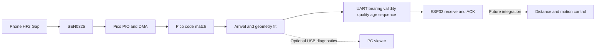

# Standalone Pico localization — engineering design notebook

Updated 12 November 2026. This document records reviewable requirements, engineering choices, calculations and evidence, not private reasoning. [中文](DESIGN_NOTEBOOK_ZH.md) · [Setup](README_EN.md) · [Current communication stage](COMMUNICATION_NOTEBOOK_EN.md)

**Current decision: pause further FFT and dual-core optimization, keep the boards and first complete SEN0325 → Pico → ESP32 communication.** FAST is the active communication backend. W1C1 is offline verified/built only; dual-core has no implementation. Pico communication Flash 11958e93 and ESP desktop merged image 36610897 have been written and verified. Runtime/reboot evidence belongs in the communication notebook; a verified write alone is not acoustic or cold-start acceptance.

## 0 Platform and toolchain

| Component | Actual stage configuration | Verification source |
|---|---|---|
| Pico | Raspberry Pi Pico / RP2040, 120 MHz core0 | Build `PICO_BOARD=pico`, `PICO_PLATFORM=rp2040`; firmware clock setup |
| Pico framework | **Native C11/C++17 and Pico SDK 2.3.1**, not Arduino | CMake and SDK version file; commit `079c6f39023649b154152db30f1d781e884879bc` |
| Actual compiler | **Arm GNU Toolchain 14.2.Rel1**, build arm-14.52; GCC/G++ **14.2.1**, 20241119 | Used build's compiler configuration and executable version |
| Build tools | CMake **4.4.4**, Ninja **1.13.2.git.kitware.jobserver-pipe-1** | Local version commands |
| Pico writing | picotool **2.3.1** | Version and verified load log |
| ESP board | **NodeMCU-32S / classic ESP32, not ESP32-S3** | Physical board and FQBN `esp32:esp32:nodemcu-32s` |
| ESP tools | Arduino IDE **2.3.8**, CLI **1.4.1**, **esp32 by Espressif Systems 3.3.12**, esptool **5.5.0** | Installed versions and build/upload evidence |
| Local ports | ESP COM6; current Pico Flash COM8 | This connection only; re-detect elsewhere |
| Optional monitor | Python **3.12.4**, pyserial **3.5** | Interpreter and package metadata |
| Native C comparison | Cygwin GCC **4.8.3** | Host test environment, not the firmware compiler |

Communication flags are `GAP_INTEGER_FFT=ON`, `GAP_INTEGER_FAST=ON`, `GAP_WHITEN_FLOAT=OFF`, `GAP_MAG_CACHE=OFF`. Flash uses `PICO_NO_FLASH=OFF`; temporary RAM tests use ON. Preserve image, flags, source snapshot and toolchain identity together.

## 1 Requirements

The phone plays the existing HF2 Gap beacon, SEN0325 receives it, and **Pico itself recognizes the beacon and computes direction** before sending a result to ESP32. With independent power, operation should not require a PC command, Python process or serial reader. The PC is for monitoring, display calibration and debugging.

This replaces the older PC-computation workflow. An earlier PC-to-Pico relay prototype was saved but not deployed; it cannot establish standalone localization. This stage includes a standalone prototype and communication validation, not motors, distance control, obstacle avoidance or a complete following robot.

Constraints: preserve 18–22 kHz HF2 Gap and 48 kHz sampling; allow large direction changes; preserve microphone wiring and GP0/GP1 UART; validate in stages and retain recoverable versions. The C prototype recognizes one fixed template. Importing another file into the phone player does not configure Pico to recognize it.

## 2 Responsibilities

| Function | Earlier Pico + PC combination | Current standalone implementation |
|---|---|---|
| Beacon playback | Phone | Phone |
| Seven-mic synchronized capture | Pico PIO/DMA/unpack | Pico, same sample format |
| Code detection and bearing | PC | Pico |
| New direction and age | PC internal events | Pico UART record |
| Radar display | PC | Optional PC telemetry |
| Distance, avoidance and wheels | Not integrated in this contribution | Future ESP/team integration |



USB may still supply power. Independence means no PC computation, collection command or continuous read is necessary. RAM test images disappear on power loss; Flash and cold-start behavior need their own verification.

## 3 Signal and geometry

The existing waveform/code has a 4096-sample period: 2048 active coded samples, then 2048 silent samples.

| Calculation | Result | Meaning |
|---|---:|---|
| 4096 / 48000 | 85.333 ms | One analysis window / template period |
| 2048 / 48000 | 42.667 ms | Active or silent half |
| 4096 × 7 × 2 | 57344 B = 56 KiB | PCM16 capture window |
| 0.04 / 343 × 48000 | 5.598 samples | Maximum horizontal center-to-ring delay |
| 0.08 / 343 × 48000 | 11.195 samples | Maximum opposite-microphone delay |

The current geometry uses 40 mm radius and sound speed 343 m/s. Installation orientation/channel offsets still require calibration; source height changes the 2D projection.

Channels are D0L, D0R, D1L, D1R, D2L, D2R, D3R_CENTER. Raw 0° is array U7/M0, increasing clockwise. The viewer's Set Front offset is not automatically a robot-front calibration.

A nearer microphone receives a source earlier. Keep the sign in `arrival_i - arrival_j = -(Fs/c) × (position_i-position_j)·direction`. Reusing a phase-slope sign without checking this relation can flip the result by 180°.

## 4 Why matched envelopes and arrival fitting

The first port uses code correlation → candidate arrival peaks → geometric consensus. It omits the larger desktop spectral-delay and joint-direction recovery searches.

The initial read-only comparison of two November 5 recordings, 40 windows total, found matching validity decisions between Python arrival-only and the full path; common valid angles differed by up to about 6.95°. The phone was moving without ground-truth angle labels. This justified a prototype, not an accuracy or Pico speed claim. Later C/Python comparisons are recorded in section 9.

Processing:

1. Reject capture faults/clipping for control use.
2. Process seven FFTs sequentially against the same HF2 template, reusing workspace.
3. Apply bounded spectral whitening so a narrow electronic tone does not dominate correlation. This does not physically increase microphone sensitivity.
4. Apply the existing 12.5 dB PNR and 0.25 band-RMS criteria. At least four microphones constitute a code hit. This arrival-only path needs at least six before fitting and at least five after at most one outlier removal; four/five hits can therefore yield no direction.
5. Select real local peaks around one arrival event and fit 2D direction plus common arrival time.
6. Report this window's fit and quality without consulting the previous bearing to restrict turns. Caller confirmation and age then determine final valid; USB separates `fit_valid`, `confirmed` and `valid`.

Amplitude-only steering is affected by speaker orientation/reflection; a lone 20 kHz carrier phase has spatial ambiguity; copying all NumPy intermediates would exceed memory. Integer FFT/FAST arithmetic were subsequently validated with a retained float baseline. No downsampling or frequency change was introduced. Further arithmetic optimization is paused.

## 5 Memory and computation limits

RP2040 has 264 KiB SRAM: a main 256 KiB region and two 4 KiB regions. Historical linker figures below are not live memory measurements.

| Main-RAM quantity | Validated v0.6 capture firmware | Undeployed v0.8 relay |
|---|---:|---:|
| RAM-loaded code/constants/initialized data | 109416 B | 114040 B |
| BSS including audio | 138104 B | 140472 B |
| Fixed main-RAM footprint | 247520 B | 254512 B |
| Linker heap-region upper bound | 14624 B | 7632 B |

v0.8 also reserved a 4096-byte core0 stack in a separate region. ELF text is not all executable instructions, and linker heap capacity is not runtime free memory.

The new design reduces DMA blocks from 1024 to 512 frames, making double-buffer storage 32 KiB instead of 64 KiB. PCM stays 56 KiB. Measured ARM DSP static workspace is 55944 bytes, within the 56 KiB target. Flash XIP stores code/constants; RAM candidates allow recoverable tests. Current image-specific ELF/resource audits, not old estimates, determine capacity. Stack high-water has not been measured.

The clock is 120 MHz and only core0 is active. An idle core1 does not prove realtime headroom. Earlier block `process_us` did not include all CRC/USB work and cannot establish a CPU-utilization percentage.

## 6 Scheduling and future control

The auditable first schedule is fresh window → estimate → output → next fresh window. It does not claim gapless processing. PIO/DMA continue during DSP, but those windows are skipped; capture ownership must remain correct. USB diagnostics are bounded/best effort so a missing PC reader should not stop localization.

Measure two distinct quantities: the fresh-direction cycle (capture, DSP and scheduling) and the eventual motor-control period. A future 10–20 ms control loop is only a proposal, not implemented performance. Repeatedly reading an old angle produces no additional measurements. Measure worst-case DSP and real feedback before deciding on timed tasks or core1; a small PID cannot provide a fixed period when appended to a long blocking loop.

## 7 Pico–ESP32 contract

GP0/TX → ESP P16/RX, GP1/RX ← ESP P17/TX, common GND; 115200 8N1 at 3.3 V, separate USB supplies without shared 3V3/5V/VIN rails.

H/B/ACK uses a fresh boot session, increasing sequence, CRC16, valid, angle, quality and age. Quality is an engineering score, not probability. Invalid is not a straight-ahead command. Age is measured from window center to actual transmission, including roughly half a window (42.67 ms) and computation. Expiry is 500 ms with 20 ms communication allowance; confirmation requires two code hits less than 750 ms apart. Do not conceal slow computation by zeroing age or relaxing deadlines. Communication v0.2 retains diagnostic raw values separately from valid targets; see the bilingual communication notebooks.

## 8 Failure predictions

| Symptom | Candidate cause | Check |
|---|---|---|
| Global 180° reversal | Arrival sign/channel order | Synthetic full circle, then known physical angle |
| Constant angle offset | Array and robot-front frames differ | Explicit front calibration |
| Jump toward a reflection | Multipath/weak peak selection | Current-window peaks and residuals; no large-turn lockout |
| Arrow without beacon | Loose detector/wrong-code collision | Silence, background, tone and wrong code separately |
| Runs only with PC | Blocking USB or PC-command dependency | No-reader and independent-power tests |
| ESP rejects old fit | Slow computation or bad age calculation | Capture/DSP/age/ACK measurements |
| Reboot rejection | Session reuse/sequence reset | New-session reboot test |
| Corruption or crash | DMA overwrite, stack or queue overflow | Ownership, drop counters, bounds and sustained tests |

## 9 Acceptance and evidence

| Stage | Current evidence / limitation |
|---|---|
| Requirements and wiring | Defined; user confirmed the three UART wires |
| Original firmware backups | Pico 2 MiB range verified; full ESP32 4 MiB matched device checksum; private, not shipped |
| C implementation | Present; ARM workspace 55944 B |
| Initial numerical port | 144 synthetic directions match Python arrival; maximum difference about 0.000657°; large-turn cases pass |
| Wrong-code selectivity | Not passed: some same-band different codes are accepted by both C and original PC path, potentially across confirmation windows |
| Recorded comparisons | 40 windows match raw arrival results; 25 geometric fits versus 23 full-PC outputs including confirmation; 160 background windows yield none |
| Pico builds/runtime | RAM/Flash built; float/integer/FAST measured; v0.2 Flash written/verified; latency remains too high |
| Independent startup | Software reboot and no-Pico-reader output observed; physical cold start remains a separate check |
| Motor loop | Future phase, not implemented |

Computer agreement is not ground-truth direction accuracy. Record physical direction, distance, motion and audio pauses. User pauses are not automatically software dropouts.

## 10 Documents and evidence ownership

Use [README_EN](README_EN.md) / [README_ZH](README_ZH.md) for setup and [communication EN](COMMUNICATION_NOTEBOOK_EN.md) / [ZH](COMMUNICATION_NOTEBOOK_ZH.md) for current interface acceptance. Python references remain [highband matching](../legacy/pico+computer%20combo%20sensoring%20version/SEN0325-Pico-Setup/highband_dsp.py) and [arrival fitting](../legacy/pico+computer%20combo%20sensoring%20version/SEN0325-Pico-Setup/arrival_dsp.py). `dsp/` is portable C; `main.c` is capture/scheduling/transport; `tests/` is offline comparison.

Each stage records requirements, changes, evidence and unresolved criteria. Raw/device evidence remains **local evidence, not shipped**. Public summaries are planned under `reports/communication-2026-11-12/`; do not embed personal installation paths or private device dumps in public documentation.

## 11 Board timing and bandwidth budget

The current real-delay target is **0.2–0.5 seconds**, replacing the earlier 0.5–1 s discussion. Separately evaluate measurement age, update period, first confirmation and actual sound-to-display delay. Existing device timing lacks a synchronized phone acoustic-onset marker.

Original Flash backups were verified privately. The mature combination archive contains 68 verified files; its historical ZIP SHA256 is `2fae8fad70b2501d3766234f89c724936717bccbcb042dd43b2300fd8b4a53d9`. Current launch/update entries open the standalone monitor without flashing or PC estimation. An earlier apparently successful playback actually used the old v0.6 capture + PC estimator; it is not standalone acceptance.

| Historical candidate | Input condition | Median DSP | Cycle/interval | Age |
|---|---|---:|---:|---:|
| Float RAM | 5 windows, no detected beacon | 2734 ms | about 2827 ms | about 2779 ms |
| Integer RAM | 13 windows, no detected beacon | 1040 ms | about 1131 ms | 1085 ms |
| Integer FAST RAM | 17 windows during phone playback | 792 ms | cycle 885 ms | 837 ms |

Code-present windows add normalization/peak work; different signal conditions are not equal-input speed comparisons. FAST bit-exact checks compared all 580 complete result structures and 66519040 values at each FFT conversion boundary. Integer versus float decisions matched across 580 windows, with maximum angle difference 0.036026°; this is not a physical error guarantee.

Of the 17 FAST windows, 16 had seven code-positive microphones and one had one. Seven fits, nine inconsistent arrivals and one undetected beacon produced final valid=0 throughout: ages exceeded 500 ms and inter-window separation exceeded 750 ms. Diagnostic amber arrows are not control targets.

For those same windows the mean cycle was 881.24 ms: FFT/inverse 451.95, envelope/peak extraction 188.05, whitening/matching 100.35, capture/scheduling outside DSP 93.08, other DSP 42.20 and final geometric fit 5.61 ms. Unpack 14.59 ms overlaps capture and must not be added again. Moving only the final fit to ESP saves a small fraction. DSP plus unpack occupied about 91% of the measured cycle, not an exact CPU-utilization measurement or control-loop guarantee. A PC estimate of 4–16 ms is not Pico performance.

W1C1 later passed 580 offline comparisons with unchanged decisions and maximum angle difference about 0.000732°; it was built but not board tested. Dual-core remained a design. Both optimization routes are now paused. If resumed, report per-core work, waits, memory and stack rather than projecting speedup as measured performance.

### Bandwidth for later project integration

Calculated from the present source/wire format, not a logic-analyzer measurement. MB/kB are decimal; KiB is 1024 bytes.

| Interface/data | Budget | Meaning |
|---|---:|---|
| Each I2S data line | 48000 × 2 slots × 32 bits = 3.072 Mbit/s | Four lines share BCLK 3.072 MHz and WS 48 kHz |
| Four lines together | 12.288 Mbit/s | Includes padding and unused eighth channel, not one 12.288 MHz line |
| PIO state-machine clock | 128 × 48000 = 6.144 MHz | Two PIO cycles per I2S bit |
| DMA raw writes | 8 × 32-bit words × 48000 = 1.536 MB/s | DMA continues while DSP skips incoming windows |
| Seven useful 24-bit channels | 8.064 Mbit/s | Excludes I2S padding |
| Unpacked PCM16 | 672 kB/s | Hypothetical continuous unpack; current selected windows only |
| Analysis window | 57344 B = 56 KiB | A buffer size, not bytes per second |
| DMA block | 16 KiB every 10.667 ms | Two blocks total 32 KiB; ownership deadline matters |
| B record | At most 49 bytes, about 4.25 ms at 115200 8N1 | 5/s is about 2.13% of that TX direction, not total latency |
| ACK | At most 45 bytes, about 3.91 ms | Full-duplex opposite direction; foreground parsing adds time |

UART capacity is 11520 bytes/s, far below seven-channel PCM16 at 672000 bytes/s. This baud rate cannot forward raw audio to ESP32. Each DMA block currently takes about 1.824 ms to unpack and arrives every 10.667 ms; other tasks must not delay IRQs or block ownership long enough to overwrite it. PIO, DMA, GPIO and CPU deadlines all need allocation. Preserve GP6–9 data, GP10–11 clocks, GP12–13 LED reservation and GP0–1 UART.

Slow updates may conceal visible steering jitter but do not solve controller interactions. Later integration must separate sensing updates from actuation rate and use real feedback for speed/acceleration limits. No wheel stability has been demonstrated here.

## Public replay after repository cleanup

The shareable runner was rechecked against the retained mature PC reference using `--skip-real`: **187 windows, 29 checks, 27 passed and 2 known wrong-code rejection failures**. The groups are 144 circle, 37 rejection, 3 repeated wrong-code and 3 large-turn windows. The rejection group accepted 1/37 negative inputs; the repeated wrong-code group accepted 3/3. All four groups had zero C-versus-Python-arrival validity mismatches. Overall acceptance is therefore not passed.

This command used the default **float** source build, not the deployed FAST hardware image, and omitted private recordings. It tests public reproducibility and preserves the known detector limitation; it is not a new board-speed or physical-accuracy measurement. Five reference-path checks passed. Production PNR remains 12.5 dB.

```text
python pico-standalone/tests/run_offline_validation.py --skip-real --gcc <host-gcc> --output <external-output>
```

The default reference is `legacy/pico+computer combo sensoring version/SEN0325-Pico-Setup`; `--reference-app` can override it. Older standalone experiments and private compute checkpoint are maintained externally, not advertised as active files in this public tree.
