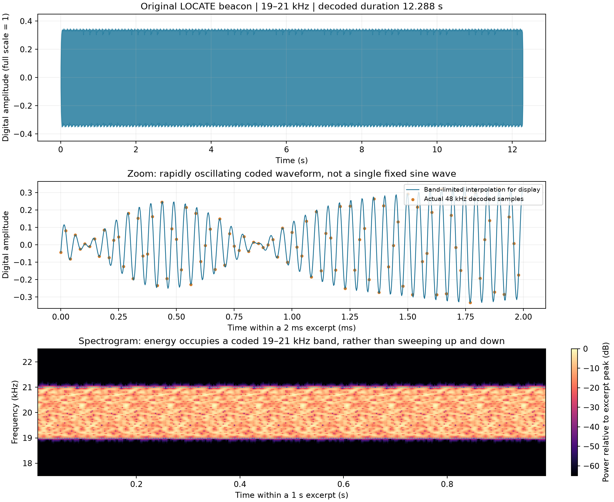
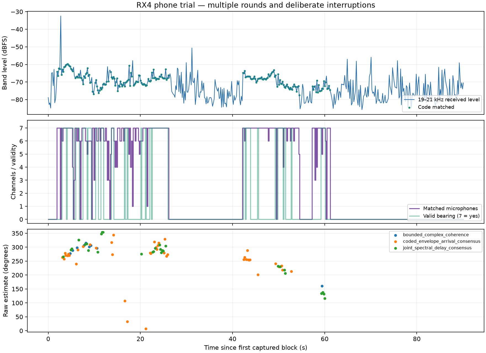
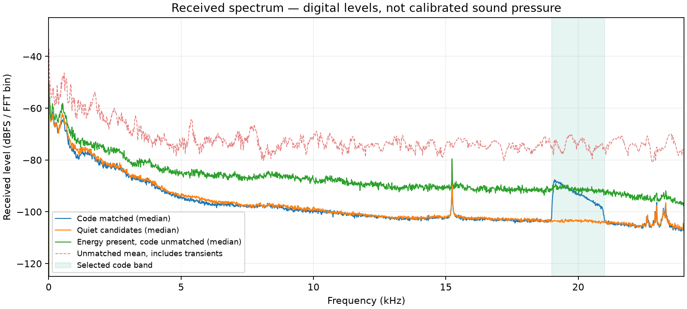
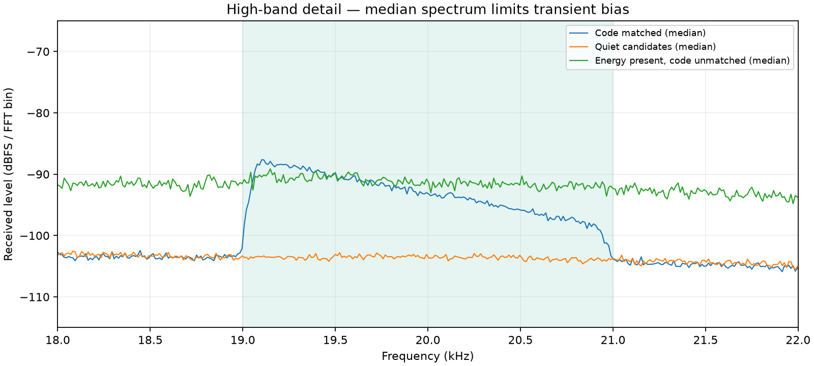

# RX4 现场音频与方向分析

2026-10-29；Windows RX4；Pico 固件 v0.6-RX2。

## 结论

这阶段有实际改善，但还没有解决全部方向波动。同一份 90.11 秒、493 个窗口的原始录音，RX3 输出 52 次方向，RX4 输出 81 次，多出的 29 次来自联合频谱时差估计。原来已接受的方向没有丢失，原始角度也没有被改写。

用户实际进行了多轮播放，并主动中断多次，最初“两轮”计划已经作废。暂停时刻和手机运动没有同步记录，所以本报告不把整场未命中次数当作接收失败率，也不把每次大角度变化都判成错误。

## 本次改动

原有估计器通过时继续使用原结果。原有两条路径都失败、且至少六路命中代码时，RX4 才尝试共同的物理时差模型：直接比较各配对完整的频谱评分曲线，寻找共同支持的方向。它检查频谱一致性、支持的通道/配对数量、物理投影范围与当前数据的峰值可辨性。

这些检查针对当前信号证据，不比较“上一帧角度跳了多少”。没有大转角屏蔽、强制反向纠正或冻结箭头的规则。原频带、编码文件、GPIO、固件和画面平滑参数保持原样。

## 原始播放波形

这张图来自 MP3 文件解码后的数字音频，不是麦克风录音。单个文件 12.288 秒，能量持续分布在 19–21 kHz；它是带限编码信号，不是固定频率的单一正弦，也不是线性上下扫频。中间的平滑曲线仅用于显示插值，没有增加实测信息。

## 接收时间轴与方向

从上到下读图：接收频带电平；命中麦克风数量和方向有效状态；各估计方法给出的原始角度。无代码区不能直接标成 bug，因为用户有意停声。绿色或橙色方向点仍需要真实方位对照，颜色不是正确/错误标签。

| 项目 | 结果 |
| --- | --- |
| 记录长度 | 90.11 s，493 窗口 |
| 至少四路命中代码 | 201 窗口 |
| 这些命中窗口中出方向 | 81 |
| 这些命中窗口中时差仍不通过 | 116 |
| 等待代码确认 | 4 |
| 方向来源 | 原主估计 9；原包络到达时间 43；新联合估计 29 |
| 正常结果间隔中位数 | 187 ms，约 5.35 次/秒 |
| 正常收包中位数 / 95分位 | 161.8 / 171.8 ms |

在连续有代码的条件下，记录到两次相邻有效估计变化超过 60°：约 14.14 s 时变化 69.64°，约 17.17 s 时变化 74.62°，两次都来自原包络到达时间路径。它们是需要复查的变化，不是已证明的误定位，因为没有同步真实方位记录。当前不会因角度变化大就封锁信号。

## 噪声与频谱

实线采用跨时间中位数，避免少数瞬态把“典型噪声”抬得过高；虚线保留高能量未匹配片段的均值，展示瞬态的影响。图中电平是数字 dBFS/FFT bin，不是校准声压。

匹配代码时，19–21 kHz 频带电平中位数约 −68.67 dBFS；按低能量、无代码条件推测的背景窗口约 −79.38 dBFS，相差约 10.71 dB。这不是严格测得的声学信噪比，因为没有精确的手机暂停标记。

另有 81 个窗口带内能量不低，但没有匹配到所选代码，包含较强瞬态。不能把它们全部认定成电子设备噪声、手机失真或接收错误。下一次固定方位测试应把播放开关、音量与手机朝向同步记录，再分离这些原因。

## 物理限制和后续范围

按当前声速配置估算，20 kHz 波长约 1.7 cm，而阵列相邻麦克风约 4 cm。仅靠载波相位会出现空间混叠风险；编码和带宽信息能够缓解，但不能恢复被噪声淹没的信息。阵列设计的间距条件可参考 [XMOS 说明](https://www.xmos.com/documentation/XM-014888-PC/pdf/xvf3800_user_guide_v3.2.1.pdf)，响应匹配与阵列处理见 [Analog Devices 说明](https://www.analog.com/en/resources/analog-dialogue/articles/how-a2b-technology-and-digital-microphones-enable-superior-performance-in-automotive-applications.html)。

本阶段不再叠加角度屏蔽。下一阶段先研究成熟项目的编码/扫频信标，并用独立文件保守对照；安卓播放器默认原样循环，音量归一化作为可选项。改变波形或频率必须同步电脑参考，不会静默替换当前默认信标。

## 如何复查

- [逐窗口 CSV](../../stages/06-joint-delay/trials/phone-trial-20261029-170010/time-series.csv)：时间、序号、电平、代码通道数、方向状态、角度和来源。
- [统计 JSON](../../stages/06-joint-delay/trials/phone-trial-20261029-170010/analysis.json)。
- [同输入 RX3/RX4 回放](../../stages/06-joint-delay/trials/phone-trial-20261029-170010/RX3-RX4-replay.json)。
- 原始七通道 NPZ、采集说明与协议更正在相同 trial 文件夹。它们是本地接收录音，没有上传到其他服务。
- [当前阶段说明](../../stages/06-joint-delay/README.md)；[角色和范围](../../docs/ROLES_ZH.md)。
