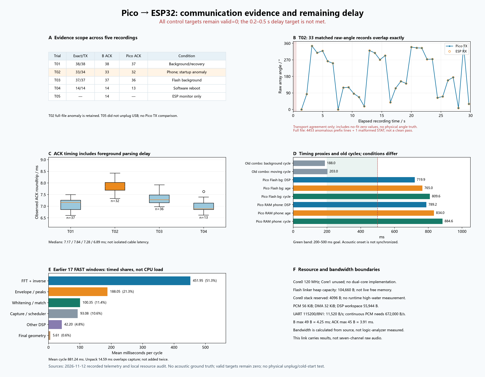

# Pico → ESP32 communication report

12 November 2026 · [中文](REPORT_ZH.md) · [Machine-readable metrics](metrics.json)

**The two boards exchange the intended result fields correctly in the observed clean runs. The standalone acoustic path is still too slow to produce a fresh control target.** After Flash deployment, 37 of 37 background TX records matched ESP32 exactly. A Pico software reboot recovered communication, and ESP32 continued receiving while no computer client opened Pico USB. Every observed control target remained invalid. This stage delivers a verified communication path and diagnostics, not a ready-to-follow robot.

## What is running

The phone plays the fixed **18–22 kHz HF2 Gap beacon**. SEN0325 supplies microphone samples; Pico captures and computes direction locally. ESP32 receives compact UART messages, checks session/sequence/age and replies with ACKs. The computer only observes telemetry in these tests; it does not compute direction or start scanning. No motor or radar commands are implemented.

| Component | Recorded configuration |
|---|---|
| Pico | RP2040, Pico SDK 2.3.1, 120 MHz core0, FAST integer FFT, v0.2-link_diag |
| Current Pico Flash artifact | SHA-256 `11958e9310926e856f01359c10c4832cffc046cb64a8edebe675b76e3984caa0` |
| ESP32 | Classic NodeMCU ESP-32S, receiver v1.1-link_diag; Arduino IDE 2.3.8, CLI 1.4.1 |
| ESP32 platform / board | **esp32 by Espressif Systems 3.3.12** / **NodeMCU-32S**, `esp32:esp32:nodemcu-32s` |
| Verified desktop ESP32 merged artifact | SHA-256 `36610897ee2f78f5fe8153d043df68cbb00b5a7cf040c7d3475dc2b3d77cda6b` |
| Link | GP0/TX → GPIO16/RX; GP1/RX ← GPIO17/TX; common GND; 115200 8N1 |

Both Flash writes were verified by the integration task. A verified write is not a cold-start test. W1C1 whitening/cache options are off in the deployed image; dual-core execution was not implemented. Further compute optimization is paused. [Setup and package installation](../../esp32-link/gap_receiver/README_EN.md) and the [decision notebook](../../pico-standalone/COMMUNICATION_NOTEBOOK_EN.md) explain the source and deployment boundaries.

The public [BUILD.json](../../esp32-link/gap_receiver/firmware/BUILD.json) records platform versions, the tested deployment hash and the four canonical source hashes; the desktop sketch differed only in its entry filename. The tested ESP32 binary contains local compiler paths and is therefore retained privately, not distributed. Public source and build instructions remain available. This packaging adjustment changes neither the installed firmware nor the trial results and supplies no untested replacement binary. New users should compile/upload source with Arduino IDE and validate their own build.

## How the records were compared

A Pico GAP record supplies a current transmission only when `tx_result_seq == seq`. For a matching UART B sequence, all four transmitted values must equal ESP32's received fields: angle, quality, age and validity. Matching CRC-valid B ACKs must have the expected sequence and status. Later Pico `ack_seq` telemetry provides separate evidence that the ACK was received; ESP logging alone establishes generation/queueing.

The analysis conservatively requires one observed ACK session per recording and does not combine ambiguous sessions by sequence alone. An unmatched observation at a file boundary is reported separately from an interior gap. USB logs are observations, not a logic-analyzer capture of every wire byte. RTT begins at Pico's first UART FIFO write and ends when its foreground loop parses the ACK, so it includes polling delay.

## Five recorded trials

“Exact/TX” compares four fields; it is **not physical direction accuracy**. “Pico ACK” counts matching receipt metadata found later in the recording. Counts refer to B ACKs only; H handshake ACKs are excluded.

| Trial | Conditions | Pico TX | ESP B rows | Exact/TX | CRC-valid B ACK | Later Pico ACK | Full observation result |
|---|---|---:|---:|---:|---:|---:|---|
| 01 | RAM, background and ESP reset recovery, 30 s | 38 | 38 | 38/38 | 38 | 37 | Consistent observed overlap |
| 02 | RAM, phone beacon, 30 s | 34 | 33 | 33/34 | 33 | 32 | **Inconsistent observation: startup anomaly** |
| 03 | Flash, warmed recorder, background, 30 s | 37 | 37 | 37/37 | 37 | 36 | Consistent observed overlap |
| 04 | Flash, Pico software reboot, 12 s | 14 | 15 | 14/14 | 14 | 13 | Consistent overlap; one leading ESP observation |
| 05 | Flash, only ESP USB monitored, 12.109 s | Not observed | 15 | Not comparable | 14 | Not observed | Continued ESP reception without a Pico reader |

Trial 01 contains one correctly rejected wrong/no-session B after ESP reset; subsequent records recover. Exact raw-field transport does not imply target acceptance. Trials 01, 03 and 04 have no interior missing observations, parse errors or observed increases in `bad`, `lines`, `ack_drop` or `usb_drop`. Each recording ends before the final packet obtains a later Pico ACK observation. That boundary is uncertainty, not proof that the ACK was lost or received.

Trial 04's extra ESP row is at the start boundary, not an extra matched Pico transmission. It verifies **software reboot/session recovery**, not a power cycle. Trial 05 contains 15 BEARING rows, 14 matching CRC-valid B ACKs and six STAT rows; the first BEARING is also at the observation boundary. Error/drop counters stayed unchanged. The Pico USB cable remained connected and supplied power: **no Pico serial reader** is the tested condition, not physical USB disconnection or independent-power cold start. Pico-side receipt cannot be checked in this run.

### Trial 02 retains its startup failure

The full 4603-event file contains **4453 anomalous ESP startup-prefix observations** within approximately 0.531 s: 1597 copies of a BEARING tail fragment and 2856 copies of one STAT line. A subsequent concatenated STAT/BEARING fragment cannot be parsed. The analysis keeps the whole file and reports `inconsistent_observation`; it does not trim this evidence to obtain a pass.

There are still 33 later matchable Pico/ESP records, all with identical transmitted fields. Figure B overlays those raw angles. Two no-fit zero values remain visible; zero degrees itself is a valid direction, and B does not carry `fit_valid`. The curve therefore demonstrates transport agreement only. Phone position was not labelled against a physical angular reference, so neither its movement nor any jump establishes angle error.

The observation rate is inconsistent with fresh 115200-baud output alone. A startup buffer/delivery anomaly is plausible; the logs do **not** establish an FTDI driver defect. Byte-partition tests of the recorder passed. The revised recorder separately saves bounded startup bytes, resets each input buffer once, aligns to LF, then begins formal timing. It does not suppress duplicate lines or errors during a trial. Warmed background and reboot trials are clean, but a warmed phone-beacon repetition remains pending.

## Detection and timing

| Trial | Code-positive microphones | Fits / windows | Fresh targets | DSP median | Measurement age median | Cycle median | ACK RTT median |
|---|---|---:|---:|---:|---:|---:|---:|
| 01 | 0 in all 38 | 0/38 | 0 | 719.008 ms | 764 ms | 810.181 ms | 7.165 ms |
| 02 | 7 in all 34 | 32/34 | 0 | 789.160 ms | 834 ms | 884.558 ms | 7.844 ms |
| 03 | 0 in all 37 | 0/37 | 0 | 719.932 ms | 765 ms | 809.641 ms | 7.277 ms |
| 04 | 0 in all 14 | 0/14 | 0 | 720.525 ms | 766 ms | 809.225 ms | 6.890 ms |

Trial 02's two failed fits report inconsistent arrivals. Its other 32 results are stale. **32/34 fit availability is not a 94% angular-accuracy claim.** Background runs correctly produced no code/fit in this limited sample; this is not a general false-positive benchmark.

Measurement age is elapsed time from the sampled window center. A cycle is the interval between processed updates. Neither is a synchronized sound-onset-to-output measurement. The unchanged receiver condition is `source_age + 20 ms + time_since_receive <= 500 ms`. Two code hits must also occur within 750 ms using window-center timestamps. Observed ages and cycles exceed these limits; `valid=0` is expected. Raw diagnostic fits are preserved without relaxing expiry or blocking large turns.

The earlier computer-DSP combination reported approximately **188 ms background / 203 ms moving-phone cycles**. Figure D includes them as context only: different tests, hardware processing paths and conditions prevent a controlled speed or accuracy comparison. Current Flash background cycle is about 810 ms; phone RAM cycle is about 885 ms. **The requested 200–500 ms target remains unmet.** Millisecond ACK timing cannot explain the hundreds of milliseconds already spent before transmission.

### Where the time is spent

A separate earlier set of 17 FAST RAM windows averaged 881.244 ms per cycle and 788.161 ms DSP. Its phase timers, displayed in Figure E, total the same cycle:

| Phase | Mean time | Fraction of cycle |
|---|---:|---:|
| Forward + inverse FFT | 451.948 ms | 51.3% |
| Envelope / peaks | 188.049 ms | 21.3% |
| Whitening / matching | 100.354 ms | 11.4% |
| Capture / scheduling outside DSP | 93.083 ms | 10.6% |
| Other DSP | 42.200 ms | 4.8% |
| Final geometry | 5.610 ms | 0.6% |

Unpacking averaged 14.585 ms and overlaps acquisition; it is not added again to this partition. `(DSP + unpack) / cycle` is about **91.1% timed work**, a scheduling/load proxy, **not measured CPU utilization**. Interrupts, DMA overlap and sampling scope prevent that interpretation. These are real Pico timer measurements, not desktop estimates, but they are a different 17-window run from Trials 02/03.

## Memory and bandwidth limits

Current Flash audit: linker heap capacity **104660 B**, core0 reserved stack **4096 B**, PCM window **57344 B**, DMA double buffer **32768 B**, DSP workspace **55944 B**. The compiler reports static application stack frames of main 792 B, report_result 1616 B, gap_estimate 560 B and send_pending_result 360 B. They are individual frames, not whole-call-chain maxima. Runtime heap availability and stack high-water were **not measured**. Core1 has no active application worker.

These bandwidth figures are calculated from the source configuration, not measured with a logic analyzer:

| Path | Budget and consequence |
|---|---|
| Microphone I2S | 48 kHz × 2 slots × 32 bits = 3.072 Mbit/s per data line; four lines aggregate 12.288 Mbit/s, not a 12.288 MHz shared clock |
| DMA raw words | 1.536 MB/s while capture runs; continuous seven-channel PCM16 would require 672000 B/s |
| Processed window | 4096 × 7 × 2 = 57344 B, 85.33 ms of samples |
| UART 115200 8N1 | 11520 B/s per direction; unsuitable for continuous seven-channel PCM |
| Maximum B / ACK | 49 B ≈ 4.25 ms / 45 B ≈ 3.91 ms wire time; opposite full-duplex directions |

At five maximum B packets per second, B traffic alone occupies about 2.13% of its UART direction. This stage therefore sends compact results; raw audio remains local to Pico. See the [bandwidth notebook](../../pico-standalone/DESIGN_NOTEBOOK_EN.md#11-board-timing-and-bandwidth-budget) for capture and DMA scheduling details.

## Remaining acceptance work

1. Repeat phone playback with the warmed recorder and fixed, labelled phone angles; separately measure pauses and large turns. Retain raw diagnostic fits but never treat stale output as a motor target.
2. Test independent-power cold start and physical USB-data removal separately from the completed no-reader observation.
3. When compute work is explicitly resumed, preserve this communication baseline and compare output decisions as well as real board time. Whitening/cache and dual-core changes are not part of this deployed milestone.
4. Measure synchronized acoustic onset-to-output delay and runtime stack headroom before claiming a usable 0.2–0.5 s control path. Angle calibration, distance sensing and motor integration remain separate.
5. Resolve the known wrong-code negative cases before treating code detection as target identity. The separate public **float reference** regression has 187 windows and 29 checks: 27 pass, two fail; it accepts 1/37 ordinary negative examples and 3/3 repeated-wrong-code windows. These are offline estimator findings, not communication failures or a FAST-on-Pico wrong-code benchmark. See [validation and limits](../../docs/VALIDATION_EN.md).

## Files and reproducibility

| File | Role |
|---|---|
| `REPORT_EN.md`, `REPORT_ZH.md` | Separate English/Chinese interpretation and limitations |
| `metrics.json` | Sanitized counts, timing distributions, plotted angle/RTT series and private-source hashes |
| `figures/communication_EN.png`, `figures/communication_ZH.png` | Shareable six-panel figures |
| `build_report.py` | Offline aggregation/plotting only; never accesses serial ports |

The maintainer can regenerate figures with `python -B build_report.py --private-output <dated-local-output-directory>`. It requires Python, Matplotlib and the retained private trial summaries/events plus task/resource audits. The full Trial 02 input is `analysis-trial-02-phone-full/summary.json`. These private sources are intentionally not shipped. Their hashes in metrics identify the inputs without exposing personal paths, USB serial identifiers, sessions or microphone audio. ESP native/startup checks passed 57; Pico extracted-main checks passed 107 and link checks 41. Those are logic tests, separate from the recorded hardware trials above.
