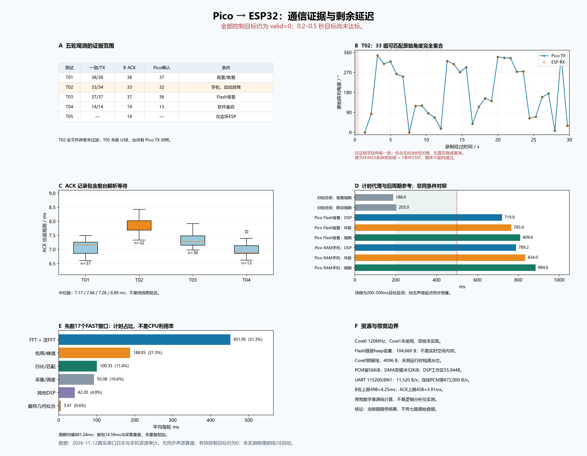

# Pico → ESP32 通信阶段报告

2026 年 11 月 12 日 · [English](REPORT_EN.md) · [结构化数据](metrics.json)

**目前两块板子已经能正确传送我们要的结果字段，但 Pico 独立计算还太慢，暂时不能给小车提供及时有效的方向。** 写入 Flash 后，背景测试的 37 个 Pico 发送记录与 ESP32 全部一致；Pico 软件重启后能恢复通信；电脑不开 Pico 串口时，ESP32 仍持续收到数据。本阶段验证了通信和诊断链路，没有完成可直接跟随人的机器人。所有实测控制目标仍为无效。

## 当前各部分负责什么

手机播放固定的 **18–22 kHz HF2 Gap 信标**。SEN0325 提供麦克风数据，Pico 自己采集和计算方向，ESP32 接收简短的 UART 结果，检查会话、序号和时效，再发回 ACK。电脑在这些测试中只看日志，不计算方向，也没有发送开始扫描命令。当前没有电机或雷达控制。

| 部分 | 本次配置 |
|---|---|
| Pico | RP2040，Pico SDK 2.3.1，core0 120 MHz，FAST 整数 FFT，v0.2-link_diag |
| 当前 Pico Flash 文件 | SHA-256 `11958e9310926e856f01359c10c4832cffc046cb64a8edebe675b76e3984caa0` |
| ESP32 | 经典 NodeMCU ESP-32S，接收器 v1.1-link_diag；Arduino IDE 2.3.8、CLI 1.4.1 |
| ESP32 板包与型号 | **esp32 by Espressif Systems 3.3.12**；**NodeMCU-32S**，`esp32:esp32:nodemcu-32s` |
| 已核验桌面 ESP32 merged 文件 | SHA-256 `36610897ee2f78f5fe8153d043df68cbb00b5a7cf040c7d3475dc2b3d77cda6b` |
| 接线与串口 | GP0/TX → GPIO16/RX；GP1/RX ← GPIO17/TX；共地；115200 8N1 |

两块板子的 Flash 写入均已由集成任务核验，但写入核验不等于冷启动测试。当前部署版本没有开启 W1C1 白化/缓存选项，也没有实现双核。进一步的算力优化已暂停。安装步骤见 [ESP32 说明](../../esp32-link/gap_receiver/README_ZH.md)，实现取舍见 [通信工程笔记](../../pico-standalone/COMMUNICATION_NOTEBOOK_ZH.md)。

公开的 [BUILD.json](../../esp32-link/gap_receiver/firmware/BUILD.json)记录平台版本、已测试部署哈希和四份正式源码哈希；桌面工程只更换了主文件名。已测试的 ESP32 二进制含本机编译路径，因此保留在本机，不随项目分发；源码和构建说明仍公开。本次打包调整没有改变板上固件或测试结果，也没有提供未经测试的替代二进制。新使用者应通过 Arduino IDE 从源码编译上传，并验证自己的构建。

## 怎么判断传输是否正确

只有 `tx_result_seq == seq` 时，才把 Pico GAP 日志中的 TX 字段归到本次结果。按 UART B 序号匹配后，逐项比较角度、质量、数据年龄和有效标志，要求四项完全相同。ACK 必须 CRC 正确、B 类型、序号和状态匹配；后续 Pico 的 `ack_seq` 才能补充“回执确实收到”的证据。ESP 打印 ACK 本身只证明它生成或排队发送了回执。

分析要求每个记录具有唯一可辨认的 ACK 会话，遇到多会话不能只靠序号硬拼。开头、结尾缺一侧记录，与中途缺项分开统计。USB 日志是软件观测，不是逻辑分析仪抓到的每一个线缆字节。RTT 从 Pico 第一次写 UART FIFO 开始，到前台解析回执结束，包含轮询等待。

## 五轮真实测试

“一致/TX”指四个字段传输一致，**不代表物理方向准确率**。“Pico 确认”指后续日志里看到对应 ACK。表中只计 B ACK，不含 H 握手回执。

| 测试 | 条件 | Pico TX | ESP B 行 | 一致/TX | CRC 正确 B ACK | 后续 Pico 确认 | 整体结论 |
|---|---|---:|---:|---:|---:|---:|---|
| 01 | RAM，背景与 ESP 重置恢复，30 秒 | 38 | 38 | 38/38 | 38 | 37 | 可观测重叠部分一致 |
| 02 | RAM，手机信标，30 秒 | 34 | 33 | 33/34 | 33 | 32 | **整体观测异常：启动输出出错** |
| 03 | Flash，录制器预热后背景测试，30 秒 | 37 | 37 | 37/37 | 37 | 36 | 可观测重叠部分一致 |
| 04 | Flash，Pico 软件重启，12 秒 | 14 | 15 | 14/14 | 14 | 13 | 重叠部分一致；开头多一条 ESP 观测 |
| 05 | Flash，仅监听 ESP USB，12.109 秒 | 未观测 | 15 | 无法对比 | 14 | 未观测 | 不开 Pico 串口仍持续接收 |

第一轮在 ESP 重置后有一条 B 因会话尚未建立被正确拒绝，之后恢复。原始字段传对了，不代表接收器应把它当成有效目标。第一、三、四轮均没有中间缺项、解析错误，也没有观测到 `bad`、`lines`、`ack_drop`、`usb_drop` 增长。每轮最后一包没有等到后续 Pico ACK 日志便结束录制。这是记录边界的不确定性，不能据此证明 ACK 丢了，也不能证明收到。

第四轮多出的一条 ESP 行位于记录开头，不是多出来的一次已匹配发送。它验证了**软件重启后的会话恢复**，没有验证断电重启。第五轮共 15 条 BEARING、14 个匹配的正确 CRC B ACK、6 条 STAT；第一条 BEARING 同样在记录边界，错误/丢弃计数没有增长。Pico USB 线仍接着供电：测试的是**没有电脑程序打开 Pico 串口**，不是拔掉 USB，也不是独立供电冷启动。因为没有 Pico 日志，这轮不能验证 Pico 收到回执。

### 第二轮的启动异常没有被隐藏

完整文件有 4603 条事件。约前 0.531 秒内出现 **4453 条异常 ESP 启动前缀**：一段 BEARING 尾部重复 1597 次，同一条 STAT 重复 2856 次。接下来还有一条 STAT 与 BEARING 拼接的残行，不能解析。分析保留了全部输入，整体结论是 `inconsistent_observation`，没有删掉前缀来制造“通过”。

后面仍有 33 组能匹配的 Pico/ESP 记录，四个字段全部相同。图 B 将这些原始角度叠在一起，其中也保留了两次无拟合时发送的零值。零度本来就是合法方向，B 协议又没有 `fit_valid`，因此图只能证明字段传输一致。没有记录手机真实角度基准，也不能把曲线的移动或跳变直接解释成定位误差。

这种瞬间输出量无法仅用当时实时产生的 115200 波特率数据解释。启动缓冲或交付过程异常是合理怀疑，但**不能据此认定 FTDI 驱动故障**。录制器的字节分块测试通过。新版先保存有容量上限的启动字节，对每个输入缓冲清理一次，再对齐 LF 后正式计时；不会在测试中途删重复行或过滤错误。预热后的背景和重启测试正常，但预热后的手机播放复测仍待完成。

## 检测与时延表现

| 测试 | 检测到编码的麦克风数 | 拟合成功/窗口 | 有效目标 | DSP 中位数 | 数据年龄中位数 | 更新周期中位数 | ACK RTT 中位数 |
|---|---|---:|---:|---:|---:|---:|---:|
| 01 | 38 窗全部为 0 | 0/38 | 0 | 719.008 ms | 764 ms | 810.181 ms | 7.165 ms |
| 02 | 34 窗全部为 7 | 32/34 | 0 | 789.160 ms | 834 ms | 884.558 ms | 7.844 ms |
| 03 | 37 窗全部为 0 | 0/37 | 0 | 719.932 ms | 765 ms | 809.641 ms | 7.277 ms |
| 04 | 14 窗全部为 0 | 0/14 | 0 | 720.525 ms | 766 ms | 809.225 ms | 6.890 ms |

第二轮两次拟合失败的原因是时差不一致，另外 32 次有拟合但已过期。**32/34 表示能算出结果的比例，不能写成“方向准确率约 94%”。** 背景测试在这组有限样本中没有编码命中或拟合，并不等于完成了所有噪声条件的误报测试。

数据年龄从采样窗口中心算起；更新周期是两次处理结果的间隔。两者都不是同步测量的“声音开始到输出”的完整延迟。接收器规则仍为 `来源年龄 + 20 ms + 收到后经过时间 <= 500 ms`；编码确认还要求两次命中对应的窗口中心间隔小于 750 ms。目前年龄和周期超过这些限制，`valid=0` 符合实际。诊断用原始拟合保留，但没有放宽过期门限，也没有限制大角度转向。

旧电脑计算组合版曾记录约 **背景 188 ms、手机移动 203 ms 的周期**。图 D 只把它们作参考：测试条件、处理硬件和场景不同，不能当成严格速度或精度对照。目前 Flash 背景周期约 810 ms，RAM 手机周期约 885 ms。**200–500 ms 的要求仍未达到。** ACK 往返只在几毫秒级，解释不了发送之前已经花掉的几百毫秒。

### 时间主要花在哪

此前另一组 17 个 FAST RAM 窗口，平均周期 881.244 ms，DSP 788.161 ms。图 E 的阶段计时分解来自这同一组窗口：

| 环节 | 平均耗时 | 占周期比例 |
|---|---:|---:|
| FFT 与逆 FFT | 451.948 ms | 51.3% |
| 包络与峰值 | 188.049 ms | 21.3% |
| 白化与匹配 | 100.354 ms | 11.4% |
| DSP 外的采集与调度 | 93.083 ms | 10.6% |
| 其他 DSP | 42.200 ms | 4.8% |
| 最终几何拟合 | 5.610 ms | 0.6% |

解包平均 14.585 ms，与采集重叠，不能再重复加到上述总量里。`(DSP + 解包) / 周期` 约 **91.1%**，是计时工作占比，**不是实测 CPU 利用率**；中断、DMA 重叠和统计范围都会影响解释。这些计时来自真实 Pico，并非电脑速度推算，但也不是第二、三轮的同一组样本。

## 内存与带宽边界

当前 Flash 审计：链接器给出的 heap 容量 **104660 B**，core0 预留栈 **4096 B**，PCM 窗口 **57344 B**，DMA 双缓冲 **32768 B**，DSP 工作区 **55944 B**。编译器给出的单函数静态栈帧分别为 main 792 B、report_result 1616 B、gap_estimate 560 B、send_pending_result 360 B。单个栈帧不等于整条调用链最大用量。没有测量实时空闲堆或运行时栈高水位；core1 没有应用工作线程。

以下是按源码参数计算的带宽，不是逻辑分析仪实测：

| 链路 | 预算与含义 |
|---|---|
| 麦克风 I2S | 48 kHz × 2 槽 × 32 bit = 每条数据线 3.072 Mbit/s；四线合计 12.288 Mbit/s，不是共享时钟变成了 12.288 MHz |
| DMA 原始字 | 采集运行时 1.536 MB/s；连续七路 PCM16 需要 672000 B/s |
| 一个处理窗口 | 4096 × 7 × 2 = 57344 B，覆盖 85.33 ms 音频 |
| UART 115200 8N1 | 每个方向 11520 B/s，无法持续传七路 PCM |
| 最大 B / ACK | 49 B 约 4.25 ms / 45 B 约 3.91 ms；属于全双工的相反方向 |

每秒发送五个最大 B 包，单方向占用约 2.13%。因此当前链路传的是结果，原始音频留在 Pico 内部。采集与 DMA 调度详见 [设计笔记](../../pico-standalone/DESIGN_NOTEBOOK_ZH.md)。

## 后面还要验证什么

1. 用预热后的录制器重测手机信标，固定并记录真实角度，分开观察暂停和大幅转向。继续保留原始诊断，不把过期结果送给电机。
2. 独立供电冷启动、物理断开 USB 数据，需要单独验证，不能拿已经完成的“无 Pico 读串口程序”替代。
3. 明确恢复算力优化后，再以当前通信版本为基线，同时比较结果判定和真板耗时。白化/缓存、双核不属于这次已部署成果。
4. 在宣称达到 0.2–0.5 秒控制要求前，测同步声音起点到输出的延迟，以及运行时栈余量。车头标定、测距、电机接入仍需各自验收。
5. 已知错误编码负例还没有解决，暂时不能把“检测到编码”直接等同于目标身份正确。独立的公开 **float 参考实现**回归包含 187 窗、29 项检查，27 项通过、2 项失败；37 个普通负例中接受了 1 个，重复错误编码的 3 窗全部被接受。这是离线定位算法问题，不应归咎于通信，也不是 FAST 真板的错误编码测试成绩。详见[验证与限制](../../docs/VALIDATION_ZH.md)。

## 文件与复现

| 文件 | 功能 |
|---|---|
| `REPORT_EN.md`、`REPORT_ZH.md` | 独立的英文/中文解释与限制 |
| `metrics.json` | 脱敏计数、时间分布、图中的角度/RTT 数据、私有输入哈希 |
| `figures/communication_EN.png`、`figures/communication_ZH.png` | 可分享的六区图表 |
| `build_report.py` | 离线整理和绘图，不访问串口 |

维护者可用 `python -B build_report.py --private-output <本机对应日期输出目录>` 重建图表。需要 Python、Matplotlib，以及本机保存的原始事件、分析摘要、计时与资源审计。第二轮使用完整的 `analysis-trial-02-phone-full/summary.json`。这些私有输入不随项目发布；metrics 只用哈希标识来源，不暴露个人路径、USB 序列号、会话或麦克风录音。ESP 原生/启动检查通过 57 项，Pico 提取实际主函数检查通过 107 项，链路检查通过 41 项；这些是逻辑测试，与上面的真实硬件观测分开陈述。
